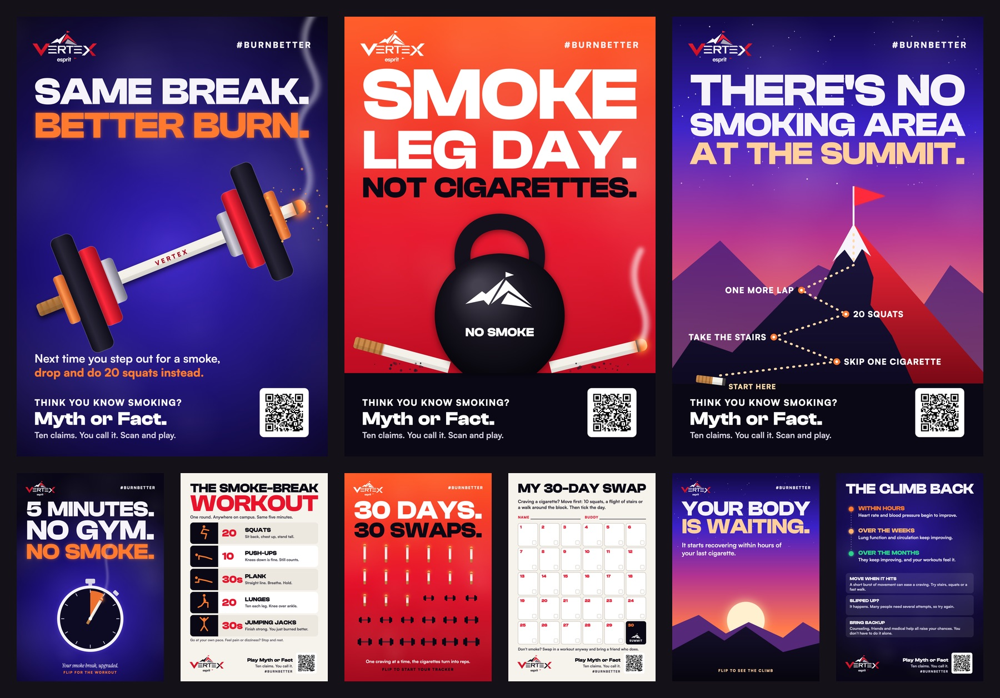

# Myth or Fact

A ten-question smoking and vaping awareness quiz that fits in one HTML file, built as the interactive half of **#BurnBetter**, a campus anti-smoking campaign.

**Play it:** https://devhmez.github.io/myth-or-fact/

## What it is

Posters and flyers around campus carry a QR code. Scanning it opens this quiz: ten common claims about smoking, and for each one you call it a myth or a fact. Every answer is followed by a short explanation, and at the end you get a score, a rank and a line you can share.

The campaign swaps the usual scare message for a fitness one: take the same break, burn something better.

## How it is built

- One `index.html` with inline CSS and JavaScript. No framework, no build step, no network requests after the page loads, so it opens instantly on a phone from a QR scan.
- Designed for one-handed use on a phone, with haptic feedback where the device supports it.
- Results are shared through the device's native share sheet, with a clipboard fallback.

## Run it

Open `index.html` in a browser.

## Status

Finished and live. Made with team Vertex at ESPRIT for an English-class awareness campaign.

Built by [Hamza Dellai](https://github.com/devhmez).
